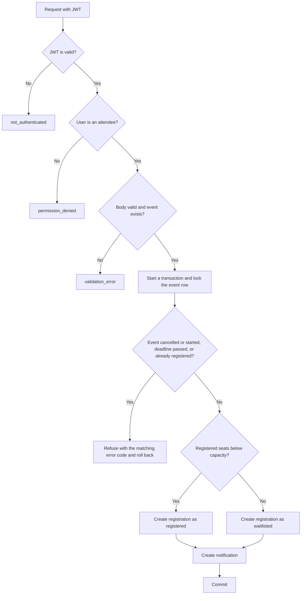
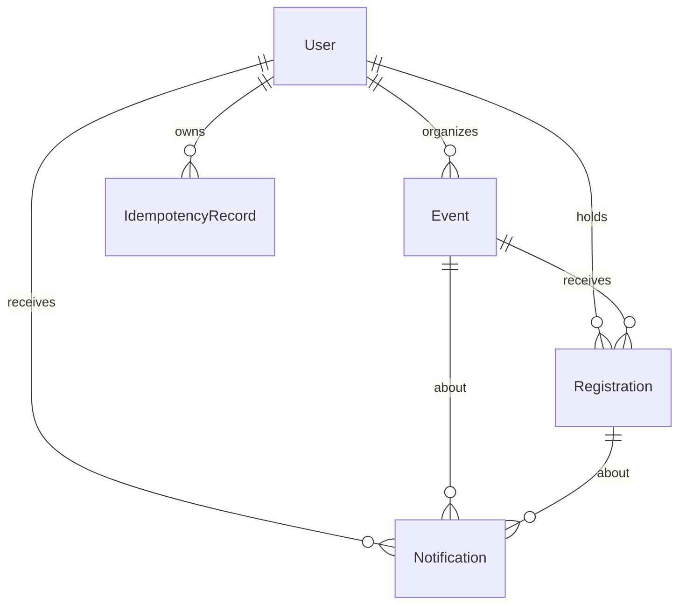

# Event Registration API

This API lets organizers publish events and attendees register for them. When an event is full, new registrations join a waitlist and are promoted automatically when a seat opens. Attendees get notifications about their registration and about changes to the event.

There is no frontend. The API and its Swagger page are the whole product.

See [ARCHITECTURE.md](./ARCHITECTURE.md) for the system architecture diagram and request-flow charts.

## Features

- Register and sign in as an organizer or an attendee, with JWT access and refresh tokens.
- Create, edit, cancel, list, search and filter events.
- Register for an event, cancel a registration, and see your registrations.
- Fixed seats, a first come first served waitlist, and automatic promotion when a seat is freed or capacity is raised.
- In app notifications: confirmed, waitlisted, promoted, event updated, event cancelled.
- Safe retries with an optional `Idempotency-Key` header, sign-in lockout, a request size limit and a health URL.
- A Django admin on a configurable path, a demo data command, the OpenAPI schema and a Swagger page.

## Stack

- Python 3.12 or newer
- Django 6.1.2
- Django REST Framework 3.18.3
- SimpleJWT 5.5.1
- drf-spectacular 0.30.0 for the OpenAPI schema and Swagger page
- PostgreSQL

## Setup

1. Create and activate a virtual environment:

   ```powershell
   py -m venv venv
   venv\Scripts\Activate.ps1
   ```

2. Install the dependencies:

   ```powershell
   pip install -r requirements.txt
   ```

3. Create a PostgreSQL user and database. The user needs `CREATEDB`, because the tests create their own database called `test_eventreg`.

   ```sql
   CREATE USER eventreg_user WITH PASSWORD 'choose-a-password' CREATEDB;
   CREATE DATABASE eventreg OWNER eventreg_user;
   ```

4. Copy the example settings and fill in your own values:

   ```powershell
   Copy-Item .env.example .env
   ```

   | Variable | Meaning | Default when not set |
   |---|---|---|
   | `SECRET_KEY` | Django secret key. Required, set your own. | none |
   | `DEBUG` | Debug mode. Only the exact value `True` turns it on. | off |
   | `ALLOWED_HOSTS` | Comma separated host names the server accepts. | `localhost,127.0.0.1` |
   | `DB_NAME` | PostgreSQL database name. | `eventreg` |
   | `DB_USER` | PostgreSQL user. | `eventreg_user` |
   | `DB_PASSWORD` | PostgreSQL password. | empty |
   | `DB_HOST` | PostgreSQL host. | `localhost` |
   | `DB_PORT` | PostgreSQL port. | `5432` |
   | `ADMIN_URL` | The path the Django admin is served at. See the next section. | `eventreg-manage/` |

   Use `DEBUG=True` for local work. There is no static file setup, so this project is for local use and is not set up for production.

5. Create the tables:

   ```powershell
   python manage.py migrate
   ```

6. Create an admin account. A superuser created this way gets the organizer role.

   ```powershell
   python manage.py createsuperuser
   ```

7. Start the development server:

   ```powershell
   python manage.py runserver
   ```

## The admin path

The Django admin is not at `/admin/`. It is served at the path in `ADMIN_URL`, which is `/eventreg-manage/` unless you set another value.

- The value must be one segment of letters, digits, `-` and `_`, and it must not be `admin` in any letter case. A bad value stops the project from starting.
- `/admin/` and everything under it answer the JSON `not_found` (404), like any unknown URL.
- This keeps the admin away from scans that only try `/admin/`. It is not access control. Anyone who learns the path sees the same sign in page, and the default value is public in this repository, so set your own value in `.env`. The real protection is a strong superuser password, no weak staff accounts and HTTPS. The admin sign in has no lockout.

## Try it in 2 minutes

Seed repeatable demo data:

```powershell
python manage.py seed_demo
```

This creates the users `demo_organizer` (organizer) and `demo_attendee` (attendee), both with the password `EventDemo123!` for demo use only, and three scheduled events. Running it again creates nothing new and never resets a password. Swagger loads its scripts from a CDN, so the docs page needs an internet connection.

Open [http://127.0.0.1:8000/api/docs/](http://127.0.0.1:8000/api/docs/) and try the waitlist in this order:

1. Call `POST /api/auth/register/` to create a second attendee, for example `second_attendee`, with role `attendee`.
2. Call `POST /api/auth/login/` as `demo_organizer`, copy the `access` token, and use **Authorize** to set it.
3. Call `POST /api/events/` with the event fields shown in the example below and `"capacity": 1`. Note the returned event `id`.
4. Log in as `demo_attendee`, replace the token in **Authorize**, and call `POST /api/registrations/` with `event`, `full_name` and `phone`. The status is `registered`.
5. Log in as `second_attendee`, replace the token, and register for the same event. The status is `waitlisted` with `waitlist_position` 1.
6. Log in as `demo_attendee` again and call `POST /api/registrations/<id>/cancel/` with the id from the first registration.
7. As `second_attendee`, call `GET /api/registrations/` and `GET /api/notifications/`. The registration is now `registered` and there is a `promoted` notification.
8. As `demo_organizer`, call `GET /api/events/<id>/registrations/` to see both registrations with the attendee names and emails.

## Endpoints

| Method | Path | Who can call it | Purpose |
|---|---|---|---|
| POST | `/api/auth/register/` | Public | Create an account. |
| POST | `/api/auth/login/` | Public | Sign in and receive access and refresh tokens. |
| POST | `/api/auth/refresh/` | Public | Exchange a refresh token for a new access token. |
| GET | `/api/auth/me/` | Signed in | Read the signed in account. |
| GET | `/api/events/` | Public | List and filter events. |
| POST | `/api/events/` | Organizer | Create an event. Accepts `Idempotency-Key`. |
| GET | `/api/events/<id>/` | Public | Read an event. |
| PATCH | `/api/events/<id>/` | Owner organizer | Edit an event. |
| POST | `/api/events/<id>/cancel/` | Owner organizer | Cancel an event with a reason. |
| GET | `/api/my/events/` | Organizer | List the organizer's own events. |
| GET | `/api/events/<id>/registrations/` | Owner organizer | List the registrations of the event. |
| POST | `/api/registrations/` | Attendee | Register for an event. Accepts `Idempotency-Key`. |
| GET | `/api/registrations/` | Attendee | List the attendee's registrations. |
| GET | `/api/registrations/<id>/` | Owner attendee | Read one registration. |
| POST | `/api/registrations/<id>/cancel/` | Owner attendee | Cancel a registration. |
| GET | `/api/notifications/` | Signed in | List the signed in user's notifications. |
| GET | `/api/health/` | Public | Check that the database answers. |
| GET | `/api/schema/` | Public | The OpenAPI schema. |
| GET | `/api/docs/` | Public | The Swagger page. |

Someone else's event or registration answers 404, not 403, so ids of other people's records are not revealed. A user with the wrong role on a role endpoint gets 403.

## Request fields

### Register

| Field | Rule |
|---|---|
| `username` | Required, up to 150 characters, unique ignoring letter case. |
| `email` | Required, valid email, unique ignoring letter case, stored in lowercase. |
| `password` | Required, up to 128 characters, must pass Django's password validators. |
| `role` | Required, `organizer` or `attendee`. |

### Create or edit an event

On edit, send only the fields you want to change.

| Field | Rule |
|---|---|
| `title` | Required, 3 to 200 characters. |
| `description` | Required, 1 to 5000 characters. |
| `category` | Required: `conference`, `workshop`, `meetup`, `webinar`, `networking` or `other`. |
| `event_type` | Required: `in_person`, `online` or `hybrid`. |
| `venue_name`, `address`, `city` | Up to 200, 255 and 100 characters. |
| `online_link` | Up to 2000 characters, a valid http or https URL. |
| `start_at`, `end_at` | Required, with a timezone offset. The start must be in the future and the end after the start. |
| `registration_deadline` | Optional, with an offset, not after the start. Defaults to the start. |
| `capacity` | Required, whole number from 1 to 100000. |
| `contact_email` | Required, valid email. |
| `contact_phone` | Required, `+` then 8 to 15 digits, first digit not 0. |

An in person event needs `venue_name`, `address` and `city`. An online event needs `online_link`. A hybrid event needs all four.

### Cancel an event

`reason`: required, 1 to 500 characters.

### Register for an event

| Field | Rule |
|---|---|
| `event` | Required, the id of an existing event. |
| `full_name` | Required, 2 to 120 characters. |
| `phone` | Required, same format as `contact_phone`. |
| `note` | Optional, up to 500 characters. |

## Example requests

### Register an account

```powershell
$body = @{
  username = $env:NEW_USERNAME
  email = $env:NEW_EMAIL
  password = $env:NEW_PASSWORD
  role = "attendee"
} | ConvertTo-Json

Invoke-RestMethod -Method Post `
  -Uri "http://127.0.0.1:8000/api/auth/register/" `
  -ContentType "application/json" `
  -Body $body
```

### Create an event

Use an organizer access token.

```powershell
$start = (Get-Date).AddDays(10).ToUniversalTime()
$body = @{
  title = "Ibadan Developer Meetup"
  description = "An evening of short talks."
  category = "meetup"
  event_type = "in_person"
  venue_name = "Tech Hub"
  address = "1 Example Street"
  city = "Ibadan"
  start_at = $start.ToString("o")
  end_at = $start.AddHours(2).ToString("o")
  capacity = 1
  contact_email = "organizer@example.com"
  contact_phone = "+2348012345678"
} | ConvertTo-Json

Invoke-RestMethod -Method Post `
  -Uri "http://127.0.0.1:8000/api/events/" `
  -Headers @{ Authorization = "Bearer $organizerAccessToken" } `
  -ContentType "application/json" `
  -Body $body
```

### Register for an event, safe to retry

Use an attendee access token and set `$eventId` to the id of the event.

```powershell
$body = @{ event = $eventId; full_name = "Ada Lovelace"; phone = "+2348012345678" } | ConvertTo-Json

Invoke-RestMethod -Method Post `
  -Uri "http://127.0.0.1:8000/api/registrations/" `
  -Headers @{ Authorization = "Bearer $attendeeAccessToken"; "Idempotency-Key" = "ada-first-try-1" } `
  -ContentType "application/json" `
  -Body $body
```

A successful response has this shape. The status is `waitlisted` and `waitlist_position` is a number when the event is full.

```json
{
  "id": "<registration id>",
  "event": "<event id>",
  "event_title": "<event title>",
  "event_start_at": "<timestamp>",
  "full_name": "Ada Lovelace",
  "phone": "+2348012345678",
  "note": "",
  "status": "registered",
  "waitlist_position": null,
  "created_at": "<timestamp>",
  "updated_at": "<timestamp>"
}
```

Registering again for the same event, without a key, returns HTTP 400:

```json
{
  "error": {
    "code": "already_registered",
    "message": "You already have an open registration for this event."
  }
}
```

## Events, seats and the waitlist

- Event statuses are `scheduled` and `cancelled`. Registration statuses are `registered`, `waitlisted`, `cancelled` and `event_cancelled`.
- One registration holds one seat. A new registration is `registered` while the registered seats are below the capacity, otherwise it is `waitlisted`.
- The waitlist is first come first served. When a seat is freed by a cancellation, or the capacity is raised, the oldest waitlisted attendees are promoted automatically and notified. Promotion continues after the registration deadline, until the event starts.
- Registration is refused for a cancelled event, an event that has started, after the registration deadline, and when you already hold an open registration for the event.
- An event cannot be edited or cancelled once it has started or been cancelled. Capacity cannot be set below the number of registered attendees.
- Cancelling a registration keeps the row and changes its status. Registering again afterwards creates a new row.
- Cancelling an event sets every open registration to `event_cancelled` and notifies each attendee, all in one transaction.
- Times are stored in UTC. A time without an offset is refused.
- The event list shows only scheduled events in the future. A cancelled event stays readable by its id.

### The register flow



Registering, cancelling, promoting, changing capacity and cancelling an event all take the same lock on the event row, so two requests for the last seat cannot both succeed.

## Notifications

Notifications are rows written in the same transaction as the change that causes them. They are read with `GET /api/notifications/`, newest first. Nothing is sent by email.

| Kind | Message | Sent to |
|---|---|---|
| `registration_confirmed` | You are registered for {title}. | The attendee who got a seat. |
| `waitlisted` | You are on the waitlist for {title}. | The attendee who joined the waitlist. |
| `promoted` | A seat opened up and you are now registered for {title}. | The attendee who was promoted. |
| `event_updated` | {title} has been updated. Please check the new details. | Registered and waitlisted attendees, when the time, format or place changed. |
| `event_cancelled` | {title} has been cancelled. Reason: {reason} | Registered and waitlisted attendees. |

Messages are cut to 255 characters. An attendee who cancels gets nothing, and the organizer gets no notifications.

## Safe retries: Idempotency-Key

`POST /api/events/` and `POST /api/registrations/` accept an optional `Idempotency-Key` header of 1 to 64 letters, digits, `-` or `_`. Anything else is a 400 `validation_error` that names the header.

- The first request with a key runs normally.
- The same key and the same body within 24 hours returns the stored answer with the header `Idempotent-Replayed: true` and changes nothing.
- The same key with a different body is a 422 `idempotency_key_reused`.
- A failed answer is never stored, so the key can be used again after fixing the request.
- The key is scoped to the signed in user and the endpoint.

## Sign in lockout

Failed sign ins are limited. Five failures for the same username from the same address, or twenty from one address under any username, in 15 minutes, answer 429 `too_many_attempts` with a `Retry-After` header in seconds. While blocked, the password is not checked, even if it is correct. A successful sign in clears the count for that username and address. A wrong password and an unknown username give the same answer. Register and the admin sign in are not limited.

## Limits and failures

- A request body over 1,048,576 bytes is refused with 413 `payload_too_large` before authentication. The check reads the `Content-Length` header.
- When the database cannot be reached, the API answers 503 `service_unavailable` with `Retry-After: 5` and no internal details. It recovers on its own when the database is back.
- `GET /api/health/` runs one query and answers `{"status": "ok"}`, or 503 when the database fails.

## Error format

API errors use this JSON shape. A `validation_error` adds a `fields` object that names each field.

```json
{
  "error": {
    "code": "<error code>",
    "message": "<plain sentence>"
  }
}
```

| Code | Status | Meaning |
|---|---|---|
| `validation_error` | 400 | The submitted data is not valid. |
| `not_authenticated` | 401 | Authentication is required or the token is invalid. |
| `permission_denied` | 403 | The user may not do this. |
| `not_found` | 404 | The resource, or the page of a list, does not exist. |
| `method_not_allowed` | 405 | The method is not allowed for this endpoint. |
| `event_started` | 400 | The event has already started. |
| `event_cancelled` | 400 | The event has been cancelled. |
| `registration_closed` | 400 | The registration deadline has passed. |
| `already_registered` | 400 | The attendee already holds an open registration. |
| `already_cancelled` | 400 | The registration is already cancelled. |
| `capacity_too_low` | 400 | The capacity is below the number of registered attendees. |
| `payload_too_large` | 413 | The request body is too large. |
| `idempotency_key_reused` | 422 | The key was used with a different request. |
| `too_many_attempts` | 429 | Too many failed sign in attempts. |
| `server_error` | 500 | Something went wrong on the server. |
| `service_unavailable` | 503 | The service is temporarily unavailable. |

## Lists, filters and paging

Every list returns `count`, `next`, `previous` and `results`, with 10 items per page. A page that is not a number, is zero or negative, or is past the last page answers 404. A filter value that is not valid answers 400 and names the parameter. Unknown parameters and empty values are ignored.

| Endpoint | Parameter | Meaning |
|---|---|---|
| `GET /api/events/` | `q` | Case insensitive search in title and description. |
| | `city` | Case insensitive search in city. |
| | `category`, `event_type` | Exact match on one of the allowed values. |
| | `status` | `scheduled` (the default view) or `cancelled`. |
| | `starts_after`, `starts_before` | Dates as `YYYY-MM-DD`, comparing the UTC start date, including the given day. |
| | `page` | The page number. |
| `GET /api/registrations/` | `status` | `registered`, `waitlisted`, `cancelled` or `event_cancelled`. |
| | `page` | The page number. |
| `GET /api/events/<id>/registrations/` | `page` | The page number. |

## Data model



Two rules live in the database, not only in code:

- One open registration per attendee and event, through a conditional unique constraint that applies while the status is `registered` or `waitlisted`.
- One stored answer per user, endpoint and idempotency key.

`LoginFailure` stores recent failed sign ins for the lockout. Both it and `IdempotencyRecord` are read only in the admin.

## Running the tests

The database user needs `CREATEDB`. Run one test run at a time, because runs share the `test_eventreg` database.

```powershell
python manage.py test accounts events registrations --noinput
```

Add `--parallel 4` to use several workers inside one run. A full run takes several minutes, because the tests use the real password hasher.

## Project layout

- `config/` holds the settings, the URL routes, the shared error format, the middleware, the health view and the admin path check.
- `accounts/` owns users, roles, register, login, the sign in lockout and the account admin.
- `events/` owns events, their list filters and the `seed_demo` command.
- `registrations/` owns registrations, notifications, idempotency records and the seat rules.

## Project notes

- [DESIGN.md](./DESIGN.md): the system design, the tradeoffs and how it was tested.
- [DECISIONS.md](./DECISIONS.md): each decision, the alternative rejected, and why.
