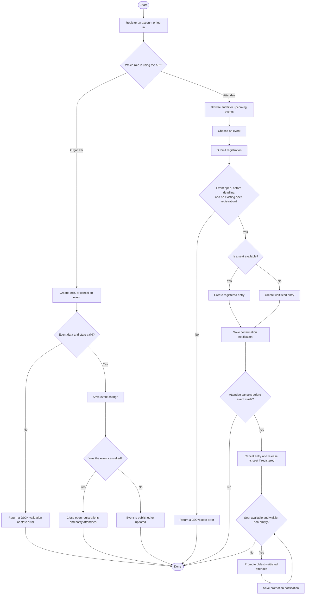
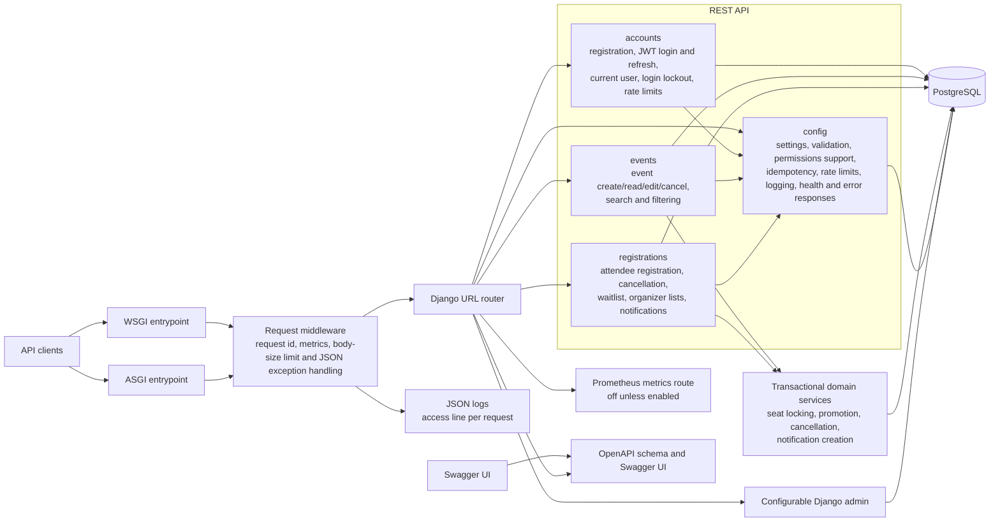
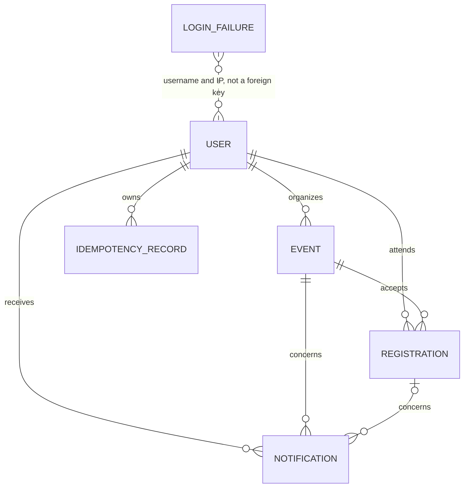
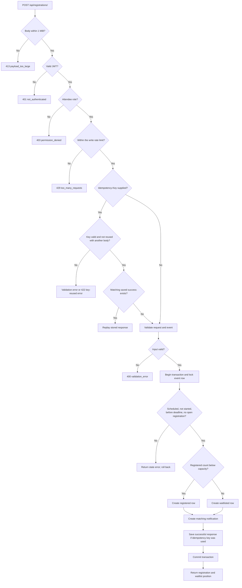
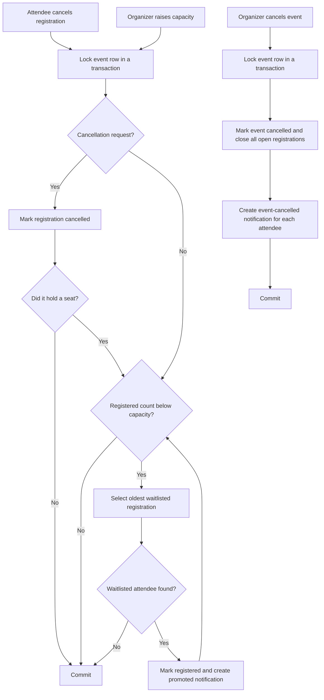

# Architecture and request flows

This repository is a Django REST Framework modular monolith. It exposes an API and Swagger UI; there is no frontend, message queue, or background worker. Notifications are database rows written in the same transaction as the event or registration change that caused them.

## End-to-end product flow

This is the user and business process from account creation through event attendance. The component diagram below it is the separate system-design view.

## System architecture

### Package responsibilities

| Area | Responsibility |
|---|---|
| `config/` | Django settings and WSGI/ASGI setup; root routes; request-id, metrics and body-size middleware; JSON error conversion; JSON log setup; the metrics route; the scoped rate limit class; health check; shared pagination and schema helpers; reusable validators, fields, and idempotent-create handling. |
| `accounts/` | Custom user and role model; public registration; JWT login/refresh; current-user endpoint; organizer/attendee permissions; database-backed sign-in lockout. |
| `events/` | Event model and admin; event validation and filtering; public event reads; organizer-only create, edit, cancel, and owned-event/registration listings. |
| `registrations/` | Registration, notification, and idempotency-record models; attendee registration/list/cancel; organizer registration view; waitlist ranking and transactional seat/promotion workflows. The seat services take plain values and never see the HTTP request. |
| `*_tests*.py` and `tests*.py` | API, security, hashing, index, structure, logging, metrics, rate limit, resilience, concurrency/idempotency, query-count, and documentation behavior tests across the apps. |
| `race_test.py`, `smoke_test.py` | Scripts that run against a live server: simultaneous requests for the last seat, and a check of every endpoint, the request id header and the metrics route. |
| `pyproject.toml`, `requirements-dev.txt` | Settings and packages for Ruff, mypy and coverage. |
| `events/management/commands/seed_demo.py` | Repeatable demo-data command. |

`manage.py` is the development and administrative command entrypoint. `config.wsgi` and `config.asgi` are the server entrypoints. Runtime settings come from environment variables; PostgreSQL is the configured database. The admin path is configurable, while the API schema and Swagger UI are public. `/metrics` always exists but answers the JSON `not_found` unless `METRICS_ENABLED` is true.

## Main data relationships

Open registrations (`registered` or `waitlisted`) are unique per attendee and event at the database level. Idempotency records are unique per user, endpoint, and key. `LoginFailure` is stored by normalized username and IP address rather than by user foreign key.

## Attendee registration and waitlist flow

## Seat release, event changes, and promotion

Event edits that change a time, venue, format, or location notify registered and waitlisted attendees. Raising capacity uses the same event lock and promotion logic. Promotion may continue after the registration deadline, but not after the event starts.

## Request-wide behavior

1. The request-id middleware runs first. It keeps a valid `X-Request-ID` from the client or makes a new one, binds it to every log line of the request, and adds it to the answer, including errors and the 413.
2. The metrics middleware times the request and records a counter and a histogram under the matched route, or `unmatched`. It skips `/metrics` itself.
3. The body-size middleware rejects oversized declared request bodies before authentication.
4. Django routes the request to the relevant API, admin, health, schema, metrics or documentation view.
5. DRF applies JWT authentication and endpoint-specific role/ownership checks, and only then the rate limit for that endpoint, so a 401 or 403 is answered before anything is counted. A passed limit answers 429. The public API returns JSON errors through the shared exception handler.
6. Create endpoints may wrap the business operation in database-backed idempotency handling. Repeating the same key and body replays the first successful response; a different body is rejected.
7. Registration and event lifecycle services use database transactions and an event-row lock to protect seat counts and keep notifications consistent with state changes.
8. After the answer, one `api.access` line is written with the request id, method, path, status, duration and user id. Log lines are JSON, and never hold query strings, bodies, tokens or passwords.

See [README.md](../README.md) for endpoint details, request fields, and examples, and [DECISIONS.md](./DECISIONS.md) for the design rationale and trade-offs.